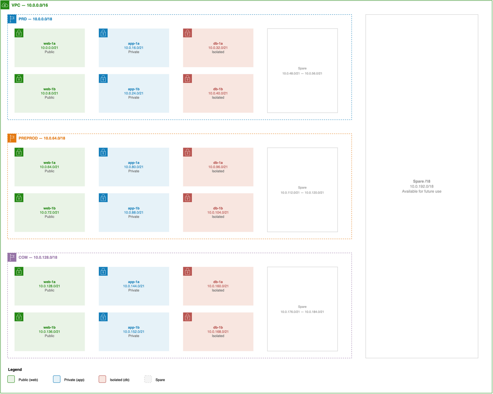
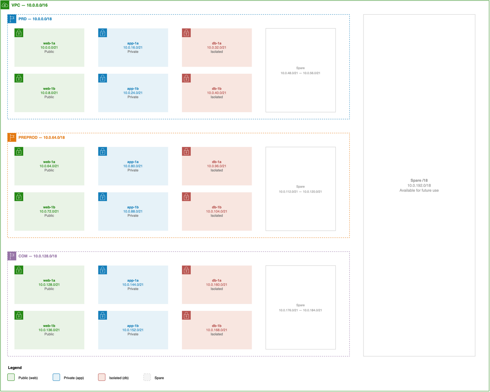

# infra-vpc

Terraform project to quickly bootstrap a VPC in any AWS account. Deploys a multi-environment VPC with public, private, and isolated subnets across 2 AZs, with optional NAT instance (fck-nat), VPC endpoints, and private DNS.

## Architecture

### VPC CIDR Overview



### Routing and Services



### Subnet Zones

| Zone | Type | Routing |
|---|---|---|
| **web** | Public | `0.0.0.0/0` via Internet Gateway |
| **app** | Private | `0.0.0.0/0` via NAT instance |
| **db** | Isolated | No internet routes |

### NAT Instance

Uses [fck-nat](https://fck-nat.dev/) on a `t4g.nano` (~$3/mo) instead of a NAT Gateway (~$32/mo). Set `enable_nat_instance = false` to skip NAT and app subnets entirely (web + db only).

### Optional Features

| Feature | Variable | Default | Cost |
|---|---|---|---|
| NAT instance (fck-nat) | `enable_nat_instance` | `true` | ~$3/mo |
| S3 + DynamoDB gateway endpoints | `enable_vpc_endpoints` | `true` | Free |
| EC2 Instance Connect | `enable_vpc_endpoints` | `true` | Free |
| Private Route53 zone | `enable_private_dns` | `true` | $0.50/mo |

## Quick Start

```bash
cd infra

# 1. Configure backend
cp config/example.tfbackend config/myaccount.tfbackend
# Edit with your S3 bucket details

# 2. Configure variables
cp config/sg.tfvars config/myaccount.tfvars
# Edit region, project_code, etc.

# 3. Deploy
terraform init -backend-config=config/myaccount.tfbackend
terraform plan -var-file=config/myaccount.tfvars
terraform apply -var-file=config/myaccount.tfvars
```

## Subnet Discovery

Other projects find subnets via standardized tags:

```hcl
data "aws_subnets" "prd_app" {
  filter {
    name   = "tag:Environment"
    values = ["prd"]
  }
  filter {
    name   = "tag:Zone"
    values = ["app"]
  }
}
```

Available tag filters:

| Tag | Values |
|---|---|
| `Environment` | `prd`, `preprod`, `com` |
| `Zone` | `web`, `app`, `db` |
| `SubnetType` | `public`, `private` |
| `AvailabilityZone` | `1a`, `1b` |

## Variables

| Variable | Type | Default | Description |
|---|---|---|---|
| `aws_region` | `string` | `ap-southeast-1` | AWS region |
| `project_code` | `string` | `vpcsg` | Naming prefix |
| `vpc_cidr` | `string` | `10.0.0.0/16` | VPC CIDR block |
| `availability_zones` | `list(string)` | `[ap-southeast-1a, 1b]` | AZs (max 2) |
| `nat_instance_type` | `string` | `t4g.nano` | NAT instance size (arm64 only) |
| `enable_nat_instance` | `bool` | `true` | NAT + app subnets |
| `enable_vpc_endpoints` | `bool` | `true` | Free endpoints |
| `enable_private_dns` | `bool` | `true` | Private Route53 zone |

## Outputs

| Output | Description |
|---|---|
| `vpc_id` | VPC ID |
| `vpc_cidr` | VPC CIDR block |
| `subnet_ids` | Map of `env-zone` to subnet ID list (e.g. `prd-web`) |
| `nat_instance_id` | NAT instance ID (null when disabled) |
| `private_zone_id` | Route53 zone ID (null when disabled) |
| `private_zone_name` | Route53 zone name (null when disabled) |

## CI/CD

GitHub Actions workflows using OIDC authentication:

1. **PR merged to main** - `terraform plan` + auto semver tag
2. **Manual dispatch** - `terraform apply`

Required repo variables: `AWS_ROLE_ARN`, `AWS_REGION`, `BACKEND_CONFIG`, `TFVARS`

## Project Structure

```
.
├── README.md
├── .github/workflows/
│   ├── 1-merge-request-plan.yml
│   └── 2-deploy.yml
├── diagrams/
│   ├── vpc-overview.drawio
│   ├── vpc-overview.png
│   └── vpc-deep-dive.png
└── infra/
    ├── terraform.tf          # Terraform + provider versions, S3 backend
    ├── providers.tf          # AWS provider + default tags
    ├── variables.tf          # Input variables
    ├── locals.tf             # Subnet CIDR calculation logic
    ├── data.tf               # fck-nat AMI lookup
    ├── vpc.tf                # VPC + Internet Gateway
    ├── subnets.tf            # All subnets (for_each on computed locals)
    ├── routes.tf             # Route tables + associations
    ├── nat.tf                # fck-nat instance + security group
    ├── dns.tf                # Private Route53 zone (optional)
    ├── endpoints.tf          # VPC endpoints + Instance Connect (optional)
    ├── outputs.tf            # Grouped outputs
    └── config/
        ├── example.tfbackend # Template backend config
        ├── sg.tfbackend      # Singapore backend config
        └── sg.tfvars         # Singapore variables
```
